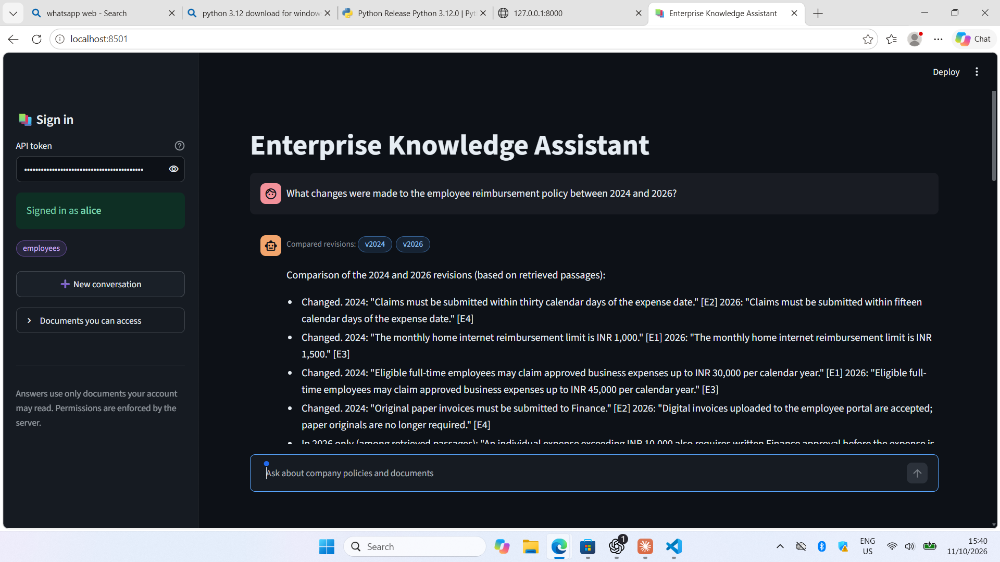
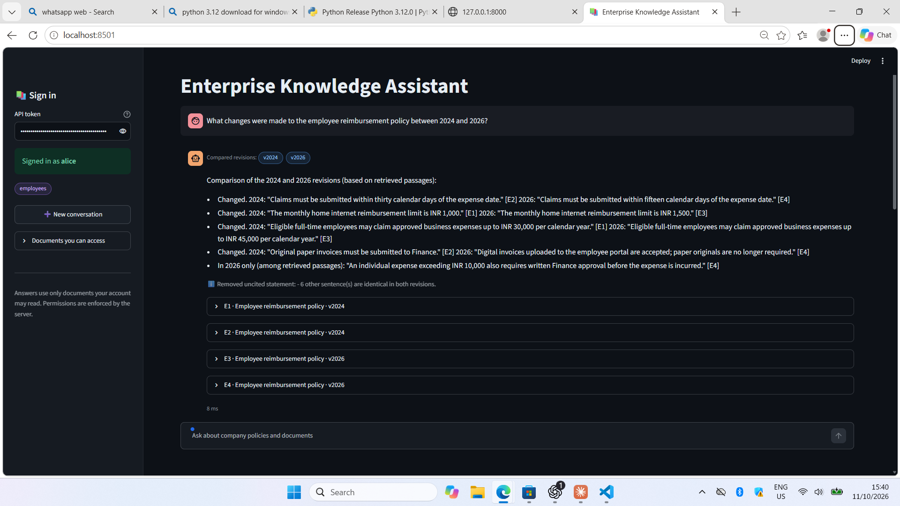
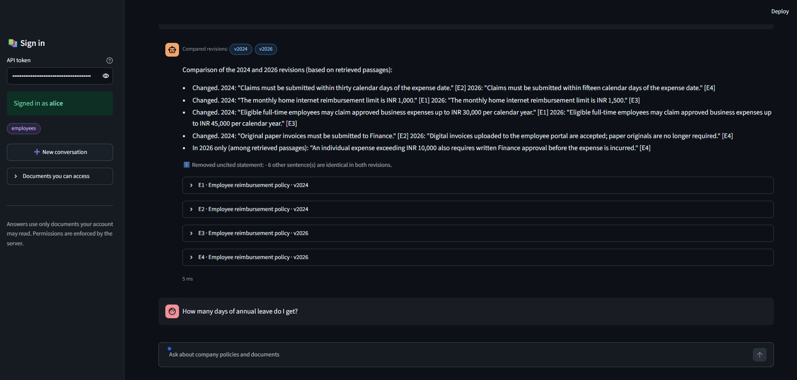
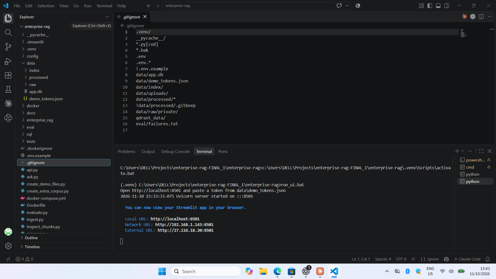

# Enterprise Knowledge Intelligence System

An assistant that answers questions from company documents (PDF, Word, Excel, HTML, Markdown, text) with
citations, version-aware comparison ("what changed between the 2024 and 2026 policy?"), follow-up questions,
and permission-controlled retrieval: a user can only get answers from documents their account may read.

Pipeline: parse -> semantic chunking -> embeddings + BM25 -> Reciprocal Rank Fusion -> cross-encoder rerank ->
cited answer (quoted passages, or a local LLM) with refusal when there is no evidence. Specification:
`docs/PROJECT_SPEC.md`. Evaluation: `docs/EVALUATION.md`. History of repaired files: `docs/RECOVERY_NOTES.md`.

## Run it on Windows (about 10 minutes, internet needed once)

1. Install Python 3.12 or newer from python.org (tick "Add python.exe to PATH").
2. Double-click `setup.bat` (creates `.venv` and installs the requirements).
3. Double-click `run_demo.bat`. It builds the index, creates demo users, and asks three questions:
   the reimbursement comparison, an HR-only question as an employee (refused), and the same question as HR (answered).
4. Web app: double-click `run_api.bat` (leave it open), then `run_ui.bat` in a second window and open
   http://localhost:8501. Paste a token from `data\demo_tokens.json` (alice = employee, bob = finance,
   carol = HR, dave = IT/security, admin = administrator). API docs: http://127.0.0.1:8000/docs
5. `run_tests.bat` runs the 49 tests.

Command line, from the project folder with `.venv\Scripts\activate.bat` active:

```
python manage.py build
python manage.py seed-demo
python ask.py --user alice "How many days of annual leave do I get?"
python ask.py --user bob            # interactive; follow-ups like "What about the submission deadline?" work
python evaluate.py                  # retrieval and answer metrics on eval/questions.jsonl
```

Linux/macOS: use `python3 -m venv .venv && source .venv/bin/activate` and the same commands.

## Real models (optional)

The default setup is offline: a hashing embedder and a heuristic reranker. For neural models:

```
pip install -r requirements-ml.txt
run_api_real.bat                    # BGE-small embeddings + MiniLM cross-encoder
```

(or set `ERAG_EMBEDDER=bge-small` and `ERAG_RERANKER=cross-encoder`, then run `python manage.py build`).
A local LLM through Ollama is also supported (`ERAG_LLM_URL=http://localhost:11434/v1`,
`ERAG_LLM_MODEL=...`), but see the results below: quoted answers scored better than a 1.5B model.
Settings are `ERAG_*` environment variables (`enterprise_rag/settings.py`).

## Measured results (40 labelled questions, 11 fictional documents)

| | Offline stand-ins | BGE + cross-encoder, quoted answers | BGE + cross-encoder + Qwen2.5 1.5B |
|---|---|---|---|
| Recall@1, test, hybrid + rerank | 0.821 | 0.893 | 0.893 |
| Answer correctness, dev / test | 0.955 / 0.952 | 0.955 / 0.952 | 0.864 / 0.857 |
| Permission leaks (must be 0) | 0 | 0 | 0 |
| Answer latency, median | ~3 ms | ~340 ms | ~4 s |

Measured on an i5-1135G7 laptop with no GPU. Treat these as indicative: the corpus is tiny and synthetic,
40 questions cannot separate configurations (one question moves a split by about 5 points), faithfulness is a
lexical proxy and not an entailment judge, and the real-model runs re-chunked the corpus slightly (34 vs 31 passages).

**Not verified:** Docker (`Dockerfile`, `docker-compose.yml`), Qdrant, PostgreSQL and the LangChain adapter have
never been executed. Treat them as untested starting points.

## Layout

- `enterprise_rag/` loaders (PDF/Word/Excel/HTML), `semantic_chunking.py`, `embeddings.py`, `vector_store.py`,
  `lexical.py` (BM25), `fusion.py` (RRF), `rerank.py`, `retrieval.py`, `rag.py` (query understanding, version
  comparison, citations, refusal), `llm.py`, `service.py` + `db.py` (login, sessions, audit), `access.py`
  (permission filter), `factory.py`, `settings.py`, `evaluation.py`.
- `api.py` FastAPI server, `streamlit_app.py` dark chat page (theme in `.streamlit/config.toml`),
  `ask.py` and `manage.py` command-line tools, `evaluate.py` and `show_failures.py` evaluation.
- `config/documents.json` document registry (title, family, version, dates, access groups).
- `data/raw/` the sample documents; `data/processed/`, `data/index/`, `data/app.db` and
  `data/demo_tokens.json` are generated and git-ignored. Demo tokens are for local testing only.
"# enterprise-knowledge-intelligence-system" 

## 📸 Application Screenshots

### 1. Enterprise Knowledge Assistant Dashboard



### 2. Policy Comparison with Version Tracking



### 3. Document-Based Question Answering



### 4. RAG Application Execution



---